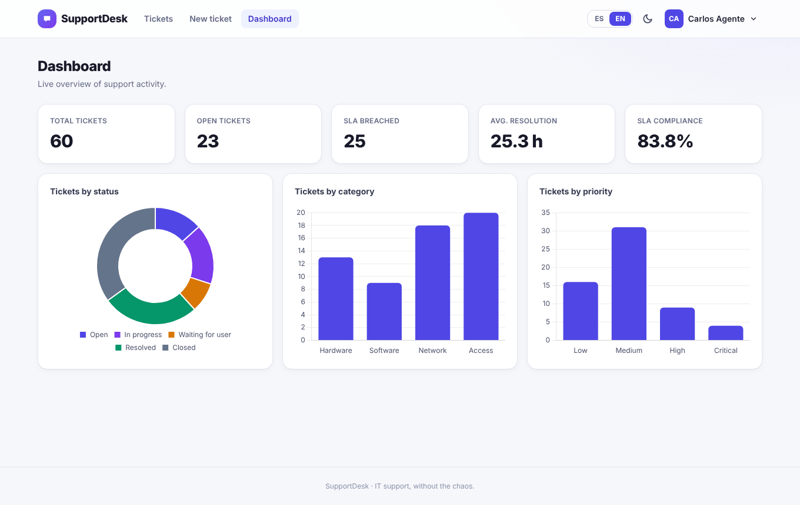
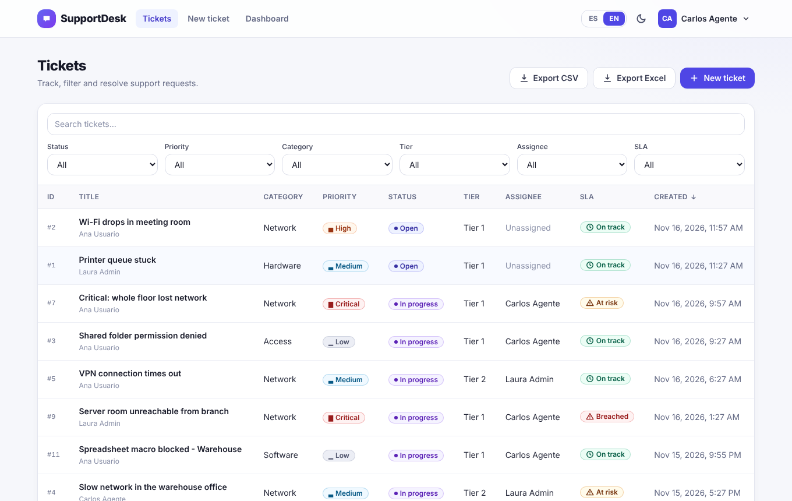
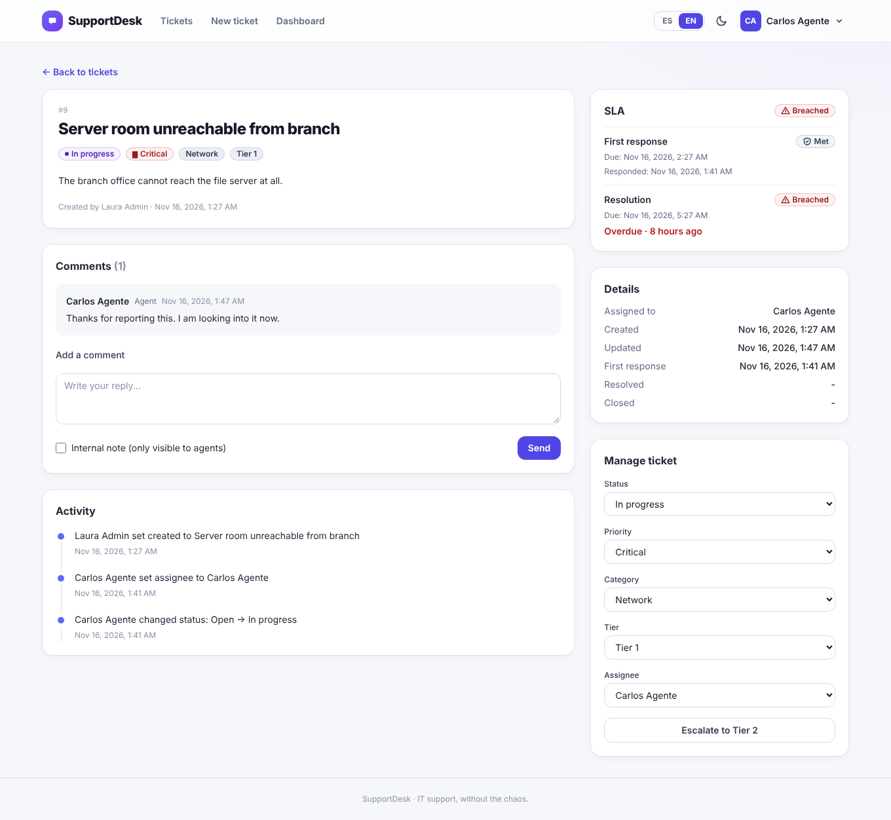
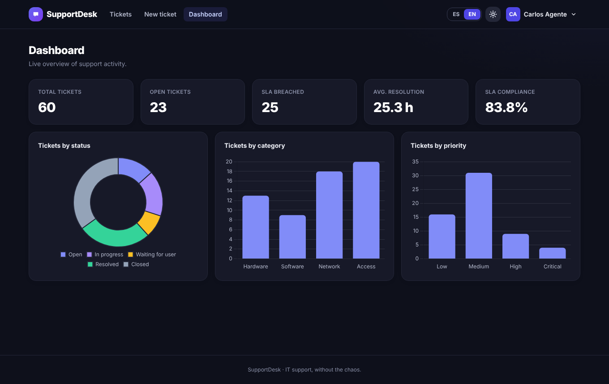
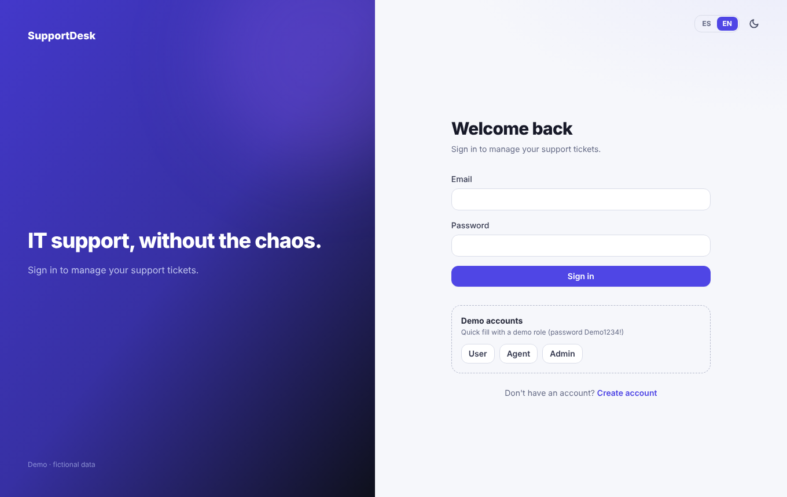
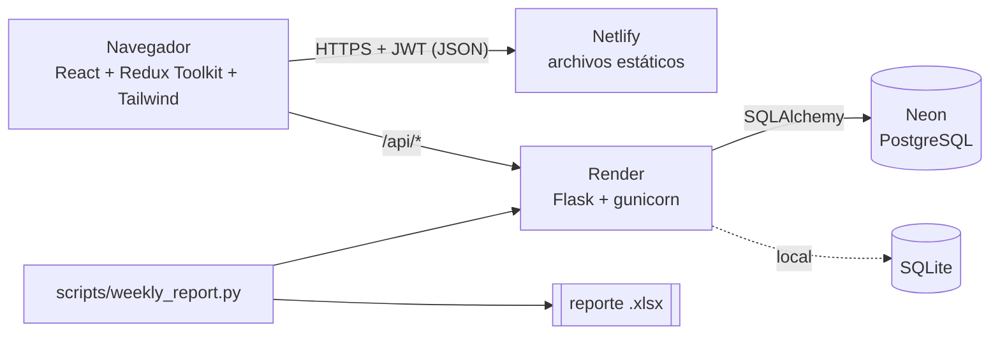

# SupportDesk

**🇪🇸 [Español](#-español) · 🇬🇧 [English](#-english)**



> ⏳ **Aviso / Notice** — La demo corre en planes gratuitos (Render + Neon): si nadie la usó últimamente, **puede tardar unos segundos en despertar** en la primera petición. / The demo runs on free tiers (Render + Neon): after a period of inactivity, **the first request may take a few seconds to wake up**.

---

## 🇪🇸 Español

### Descripción
SupportDesk es un mini sistema de tickets de soporte técnico pensado como proyecto de portafolio. Cubre un flujo real de mesa de ayuda: los usuarios abren tickets, el **Tier 1** los atiende, los casos complejos se **escalan a Tier 2**, y todo se sigue hasta resolverse **midiendo el cumplimiento de los SLA** (primera respuesta y resolución).

**Funciones:** registro/login con roles (`usuario`, `agente`, `admin`) · tickets con categoría, prioridad, estado, tier y asignación · comentarios (públicos e internos) y bitácora de cambios · SLA con marcas "en riesgo" y "vencido" · filtros, búsqueda y paginación · panel con Chart.js · exportación CSV y Excel de la lista filtrada · reporte semanal automatizado · modo oscuro · español/inglés.

**Todos los datos son ficticios.** No hay datos, nombres ni casos de empresas o clientes reales.

### Demo
- 🔗 Demo: **https://supportdeskd.netlify.app**
- API: https://supportdesk-api-xdsc.onrender.com/api/health

### Usuarios de prueba
| Rol | Correo | Contraseña |
|---|---|---|
| usuario | `usuario@demo.com` | `Demo1234!` |
| agente | `agente@demo.com` | `Demo1234!` |
| admin | `admin@demo.com` | `Demo1234!` |

La pantalla de login tiene botones de "rellenar" para cada rol.

### Capturas
| Lista de tickets | Detalle + SLA + bitácora |
|---|---|
|  |  |

| Panel (modo oscuro) | Login |
|---|---|
|  |  |

### Arquitectura


### Estructura del repositorio (monorepo) y por qué
```
supportdesk/
├── backend/            # Flask API, modelos, migraciones, scripts, pytest
│   ├── app/            # factory, models, sla.py, routes/, services/export.py
│   ├── migrations/     # Flask-Migrate (Alembic)
│   ├── scripts/        # seed.py, weekly_report.py
│   └── tests/
├── frontend/           # React + Vite + TS, Redux Toolkit, Tailwind, Vitest
├── docs/screenshots/
├── .github/workflows/ci.yml
├── render.yaml         # blueprint del backend
└── README.md
```
**Por qué monorepo:** un solo lugar para clonar, revisar y versionar; el contrato de la API y su cliente cambian juntos en el mismo commit; un único workflow de CI valida ambos lados. El despliegue sigue siendo independiente (Netlify usa `frontend/`, Render usa `backend/`).

### Cómo correrlo en local
Requisitos: Python 3.11+, Node 20+.

**Backend** (http://localhost:5000)
```bash
cd backend
python -m venv .venv && source .venv/bin/activate     # Windows: .venv\Scripts\Activate.ps1
pip install -r requirements-dev.txt
cp .env.example .env                                   # opcional; sin DATABASE_URL usa SQLite
flask --app wsgi db upgrade                            # crea las tablas
python scripts/seed.py                                 # 3 usuarios + 60 tickets ficticios (--reset para recrear)
flask --app wsgi run                                   # API en :5000
```
**Frontend** (http://localhost:5173)
```bash
cd frontend
npm install
cp .env.example .env                                   # VITE_API_URL=http://localhost:5000
npm run dev
```
**Reporte semanal (automatización)**
```bash
cd backend
python scripts/weekly_report.py                        # últimos 7 días → reports/weekly_report_YYYY-MM-DD.xlsx
python scripts/weekly_report.py --weeks-back 1 --output mi_reporte.xlsx
```
Hojas: *Summary* (totales, tiempo medio de resolución, % SLA, desglose), *Tickets* y *SLA Breaches*. Se puede programar con `cron` o GitHub Actions.

**Pruebas y calidad**
```bash
cd backend  && pytest -q && ruff check . && ruff format --check .
cd frontend && npm run lint && npm run format:check && npm test && npm run build
```
Hay **80 pruebas** (39 pytest + 41 Vitest/RTL). GitHub Actions las ejecuta en cada push.

### Despliegue (todo con planes gratuitos)
1. **Neon**: crea un proyecto y copia la cadena de conexión (`postgresql://…`).
2. **Render**: nuevo *Blueprint* desde este repo (`render.yaml`). Define `DATABASE_URL` (Neon) y `CORS_ORIGINS` (URL de Netlify). `SECRET_KEY` y `JWT_SECRET_KEY` se generan solos. Las migraciones corren al arrancar. En `APP_ENV=production` la app **se niega a iniciar con SQLite** o sin secretos.
3. **Netlify**: base directory `frontend`, variable `VITE_API_URL=https://supportdesk-api-xdsc.onrender.com`.
4. Cargar datos demo una vez (desde tu máquina con la `DATABASE_URL` de Neon exportada): `python scripts/seed.py`.

Variables de entorno: `APP_ENV`, `SECRET_KEY`, `JWT_SECRET_KEY`, `DATABASE_URL`, `CORS_ORIGINS` (backend) y `VITE_API_URL` (frontend). **Ningún secreto vive en el repo.**

### SLA
| Prioridad | Primera respuesta | Resolución |
|---|---|---|
| crítica | 1 h | 4 h |
| alta | 4 h | 8 h |
| media | 8 h | 24 h |
| baja | 24 h | 72 h |

Estados: `ok`, `at_risk` (≥ 75 % del tiempo consumido), `breached` (vencido o completado tarde) y `met` (cumplido a tiempo). Son funciones puras en `backend/app/sla.py`, por lo que se prueban sin tocar la base de datos. Se usan horas naturales y el estado "esperando usuario" no pausa el reloj (simplificación deliberada).

### Decisiones técnicas
- **RTK Query** para el acceso a la API: caché, estados de carga y reintentos con poco código; las mutaciones invalidan etiquetas y refrescan solas listas y detalle. Slices de Redux solo para sesión, tema e idioma.
- **Zod + React Hook Form**: validación tipada y compartida entre formulario y tipos.
- **Filtros en la URL**: la lista es compartible y el botón "atrás" funciona; la exportación usa exactamente los mismos filtros.
- **SLA calculado, no guardado**: siempre es coherente con la hora actual; el filtro por SLA se aplica en Python tras el filtrado SQL (suficiente a esta escala; con millones de filas se materializaría en una columna).
- **Permisos en el servidor**: la UI oculta controles, pero la API es quien decide (un usuario no ve tickets ajenos ni notas internas).
- **Bitácora automática**: cada cambio en campos rastreados escribe quién/qué/cuándo.
- **Config 12-factor** y SQLite solo fuera de producción.
- **Descarga autenticada**: la exportación usa `fetch` + `blob` porque necesita el encabezado `Authorization`.
- **Lo que no hice (a propósito):** refresh tokens, notificaciones por correo, adjuntos, SLA con horario laboral/pausas. Son los siguientes pasos naturales.

### Qué aprendí
> _Reescribe esta sección con tus propias palabras._ Puntos de partida: modelar el SLA como funciones puras facilita probarlo; mantener el contrato de la API estable permite desarrollar frontend y backend en paralelo; los planes gratuitos obligan a pensar en arranques en frío y migraciones al iniciar; la autorización debe vivir en el servidor, no en la interfaz; y desplegar con tres servicios (Neon, Render y Netlify) me enseñó a manejar variables de entorno y CORS entre ellos.

---

## 🇬🇧 English

### Description
SupportDesk is a mini technical-support ticketing system built as a portfolio project. It models a realistic help-desk flow: users open tickets, **Tier 1** handles them, complex cases are **escalated to Tier 2**, and everything is tracked through to resolution while **measuring SLA compliance** (first response and resolution).

**Features:** register/login with roles (`usuario`, `agente`, `admin`) · tickets with category, priority, status, tier and assignee · public and internal comments plus an audit trail · SLA with "at risk" and "breached" markers · filters, search, pagination · Chart.js dashboard · CSV and Excel export of the filtered list · automated weekly report · dark mode · Spanish/English.

**All data is fictional.** No real companies, customers, people or cases.

### Demo
- 🔗 Live demo: **https://supportdeskd.netlify.app**
- API: https://supportdesk-api-xdsc.onrender.com/api/health

### Demo accounts
| Role | Email | Password |
|---|---|---|
| usuario (end user) | `usuario@demo.com` | `Demo1234!` |
| agente (agent) | `agente@demo.com` | `Demo1234!` |
| admin | `admin@demo.com` | `Demo1234!` |

The login page has one-click "fill" buttons for each role.

### Architecture
See the diagram in the Spanish section above (same system): React SPA on Netlify → Flask API on Render (JWT) → PostgreSQL on Neon; SQLite locally; a CLI script generates the weekly `.xlsx`.

### Monorepo layout and why
`/backend` (Flask API, models, migrations, scripts, pytest) and `/frontend` (React + Vite + TS). **Why a monorepo:** one place to clone and review; the API contract and its client change in the same commit; a single CI workflow validates both sides — while deployments stay independent (Netlify builds `frontend/`, Render runs `backend/`).

### Run it locally
Requirements: Python 3.11+, Node 20+.
```bash
# Backend → http://localhost:5000
cd backend
python -m venv .venv && source .venv/bin/activate     # Windows: .venv\Scripts\Activate.ps1
pip install -r requirements-dev.txt
flask --app wsgi db upgrade
python scripts/seed.py            # 3 users + 60 fictional tickets (--reset to recreate)
flask --app wsgi run

# Frontend → http://localhost:5173
cd frontend
npm install && cp .env.example .env
npm run dev

# Weekly report
cd backend && python scripts/weekly_report.py   # → reports/weekly_report_YYYY-MM-DD.xlsx
```
Tests: `cd backend && pytest -q` (39) and `cd frontend && npm test` (41) — 80 in total, run by GitHub Actions on every push, along with ruff, ESLint, Prettier and the production build.

### Deployment (free tiers)
Neon (PostgreSQL) → Render (`render.yaml` blueprint; set `DATABASE_URL` and `CORS_ORIGINS`) → Netlify (base dir `frontend`, `VITE_API_URL`). With `APP_ENV=production` the API refuses to start on SQLite or without secrets. No secret is ever committed.

### Technical decisions
RTK Query for caching and tag-based invalidation · Zod + React Hook Form for typed validation · filters kept in the URL (shareable; export uses the same filters) · SLA computed on read with pure, unit-tested functions (calendar hours; "waiting for user" does not pause the clock) · server-side authorization (users never see others' tickets or internal notes) · automatic audit log · 12-factor configuration · authenticated file downloads through `fetch` + `blob`. **Deliberately out of scope:** refresh tokens, email notifications, attachments, business-hours SLAs.

### What I learned
> _Rewrite this in your own words._ Starting points: pure functions make SLA logic easy to test; a stable API contract allows parallel frontend/backend work; free tiers force you to think about cold starts and migrations on boot; authorization belongs on the server, not in the UI; deploying across three services (Neon, Render, Netlify) taught me how environment variables and CORS tie them together.

---

MIT License.
